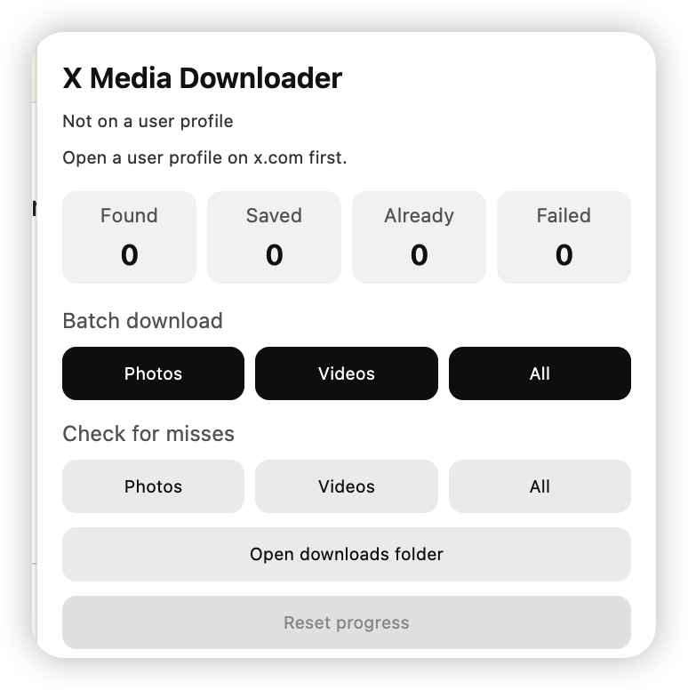

# X Media Downloader

<div align="center">

### ☕ Buy me a coffee

This project is free. If it helped you save photos or videos, tips in **USDT** on the matching network are welcome.

Send on the network listed below; a mismatched network will not be credited.


| Network | Address |
|:----:|:--------:|
|  **USDT · BEP-20** | `0x6E7359A42C466893E9A835fD6aFdb82E0D1Ed32d` |
|  **USDT** | `Hm7f6wGdvcmLmbcXV7sdLYGJKBdwGoFrJTZPzeN8dpan` |
|  **USDT · TRC-20** | `TGNrpZBqD8jnfNCb7B9W93qMmVHycoFsKJ` |

</div>

Chrome extension that downloads photos and videos from an open X (Twitter) profile, then builds a local `album.html` gallery with captions.

**Personal / private use only.** Respect X’s terms and the account owner’s rights. Do not redistribute downloaded media.

<p align="center">
  
</p>

## What it does

- Batch-download **Photos**, **Videos**, or **All** from a profile’s Media tab
- **Check for misses** to rescan and fill gaps without re-downloading everything
- Per-tweet download button on individual posts
- Writes `album.html` (or `account_album.html` on Android) so you can browse images, videos, and captions offline
- **Desktop:** files go into `Downloads / accountname /`
- **Android:** subfolders are dropped by the system, so filenames are prefixed with the account name instead

## Install

1. Open `chrome://extensions`
2. Turn on **Developer mode**
3. Click **Load unpacked** and select this folder
4. Pin the extension if you like

## Usage

1. Open a user profile on [x.com](https://x.com) (URL like `x.com/username`)
2. Click the extension icon
3. Choose **Photos**, **Videos**, or **All** under Batch download
4. Keep the X tab in the foreground while it scrolls and saves
5. Use **Check for misses** later to backfill anything that was skipped
6. Open `album.html` next to the media files to browse the gallery
7. **Reset progress** clears this account’s done list and cursors (files on disk stay). Then use Check for misses if you want a fresh scan
8. **Stop** / **Resume** and **Open downloads folder** are in the popup and on-page panel

## Android

Android Chrome does not load unpacked extensions the same way desktop Chrome does. Practical options:

- Use a Chromium-based Android browser that supports extensions (for example Kiwi or similar forks that allow installing from a folder / CRX), **or**
- Do the heavy downloading on desktop, then copy files to the phone

When the extension does run on Android:

1. Keep the X tab **in the foreground** while downloading — background tabs often stall scrolling
2. Downloads land **flat** in the Downloads folder. Android typically drops nested folders, so each file is named like `account_2024-01-01_1234567890_1.jpg` (account name prefix)
3. The album file is named like `account_album.html` (not a subfolder path)
4. **Opening `album.html` from Chrome’s Downloads preview often fails to show relative photos/videos.** Open the HTML from a file manager so it sits next to the media files
5. **Reset progress** and **Check for misses** work the same as on desktop — use them if videos were skipped or you want to backfill

### Organize flat Downloads into account folders (phone only)

After many downloads, use Termux once — **do not paste a multi-line loop**. Download the script, then run one short command.

1. Install [Termux](https://f-droid.org/en/packages/com.termux/) (F-Droid build recommended)
2. Run `termux-setup-storage` and allow storage access
3. Download the script (phone browser is fine):  
   [scripts/organize-android.sh](scripts/organize-android.sh)  
   Save it into your Downloads folder
4. In Termux, run **one** of these (try the first; if the folder is empty, try the second):

```bash
cd ~/storage/downloads && sh organize-android.sh
```

```bash
cd ~/storage/shared/Download && sh organize-android.sh
```

If the script is in Downloads but you `cd` elsewhere:

```bash
sh ~/storage/downloads/organize-android.sh ~/storage/downloads
```

It creates folders named after each account prefix and moves matching files in. `mv -n` will not overwrite existing files. Then open `account/album.html` (or `account/account_album.html` if still prefixed) with a **file manager**, not Chrome’s download preview.

## Notes

- All downloads photos first, then videos
- Already-saved items are skipped on later runs
- If you stop mid-run, start again or use Check for misses to finish
- Per-tweet buttons ignore the batch Photos / Videos / All choice
- Per-tweet downloads do not regenerate `album.html` (batch / miss-check only)

## Version

`1.2.1`
